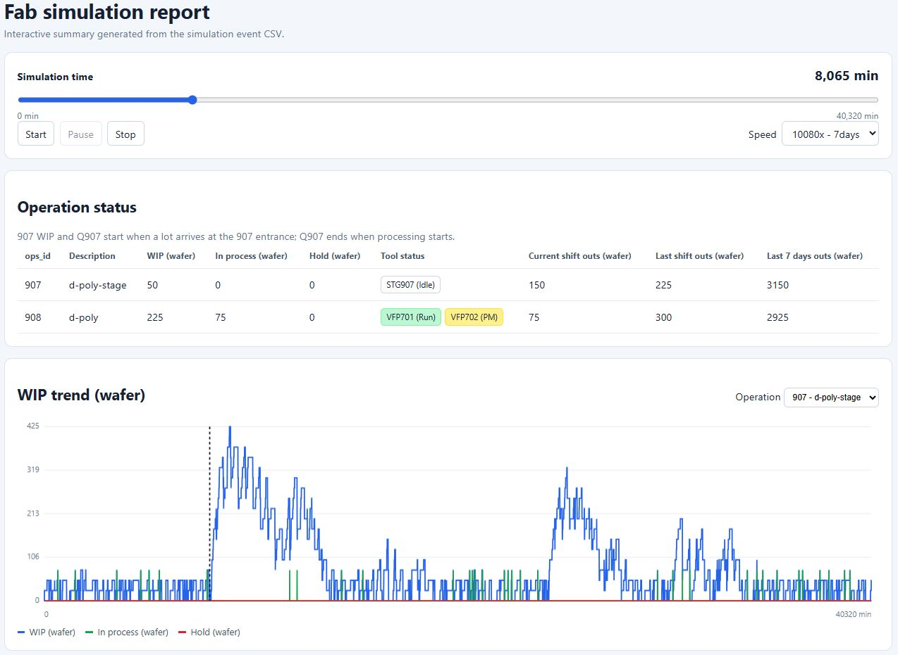

# Poly-operation fab simulation

This repository contains a small SimPy discrete-event simulation driven by the
three configuration files in `data/`:

- `poly_config_ops.csv` defines operations 907 (`d-poly-stage`) and 908
  (`d-poly`), including each operation's maximum queue time.
- `poly_config_tool.csv` defines the tools. STG907 is configured as a virtual
  tool; VFP701 and VFP702 are furnace tools with preventive-maintenance limits.
- `poly_config_tool-ops.csv` maps tools to operations and defines wafer batch
  limits and processing time per load.

## Simulation parameters

Edit `data/simulation_parameters.csv` to set the run inputs:

| Parameter | Meaning |
| --- | --- |
| `lots_per_shift` | Average number of arriving lots per 12-hour shift. Arrivals are stochastic, not evenly spaced. |
| `duration_hours` | Total simulated time. The simulation stops at this time; it does not drain unfinished work. |
| `wafers_per_lot` | Wafer count assigned to each created lot. |
| `op_907_release` | Maximum number of operation 908 batches in each tool's 908 WIP, including batches waiting to process and currently processing. The parameter name is retained for compatibility. |
| `random_seed` | Seed for reproducible random lot-arrival times. |

The checked-in parameter file currently specifies an average of 11 lots per
shift, 672 simulation hours, 25 wafers per lot, two batches per operation 908
tool, and seed 1. This arrival rate meets the combined VFP capacity to
exercise the 907 WIP queue; arrivals remain stochastic, so 11 is not a hard
per-shift maximum.

## Current simulation behavior

Install the dependency and run the simulator from the repository root:

```sh
python -m pip install -r requirements.txt
python -m fab_sim
```

Lot arrivals enter 907 WIP at the 907 entrance, starting Q907. The MILP
controller then decides when to move in/start processing a batch; Q907 stops
when processing starts. With 25 wafers per lot and a configured batch range of
37–75 wafers, valid loads contain two or three lots. The controller uses three
FIFO lots when available; if only two lots are available, it waits up to six
hours for a third and then allows a two-lot batch.

The MILP chooses a furnace tool using its current 908 WIP, expected processing
start, queue-time limit, and PM state. Each tool may have up to the configured
number of batches in 908 WIP, counting both waiting and processing batches.
Work still in 907 does not count toward this cap. The controller moves a batch
into STG907 to start processing only when the projected 908 start can meet the
908 queue-time limit. Q-time runs from arrival into operation WIP until
processing starts.

STG907 has a 1-minute processing time and a configured chamber capacity of
999999, so it is effectively parallel. Each 908 load counts as one PM run,
whether it contains two or three lots. PM is triggered by whichever enabled
limit is reached first: run count or elapsed time. A time-triggered PM waits
for an active load to finish, and no new batch starts until the PM completes.

VFP701 and VFP702 are parallel tools for operation 908. Each load counts as one
run for PM, whether it contains two or three lots. Unexpected queue-time
breaches are still recorded as `hold`. Under the 20-lots/shift
overload, Q907 may breach while lots wait at 907; the MILP screens projected
908 Q-time breaches when scheduling a batch.

## MILP formulation

The MILP is a rolling, single-candidate assignment model, not a schedule over
future arrivals. SimPy generates arrivals and advances processing and PM
events. Each solve sees the currently eligible FIFO batch and the current 908
tool/WIP/PM state; future lot arrivals are not forecast.

### Batch eligibility

Batch formation happens before the MILP solve:

- If three FIFO lots are available, the oldest three form the candidate batch.
- If only two are available, wait up to 360 minutes for a third. If it arrives
  by the deadline, use three lots; otherwise, use the two-lot batch.
- One-lot batches are not valid for the configured 37–75 wafer batch range.

Lots enter 907 WIP and start Q907 upon arrival. When the MILP finds a safe
furnace assignment, the batch moves in to STG907 and starts processing; that
processing start stops Q907.

### Assignment model

For each currently eligible furnace `m`, define the binary decision:

```text
x_m = 1 if the candidate batch is assigned to furnace m; 0 otherwise
```

Inputs for each furnace include its current 908 WIP batch count `W_m`, cap `R`,
projected processing start `S_m`, candidate's projected 908 entry time `E_i`
for each lot, processing duration `p_m`, and Q908 limit `Q_908`. The projected
start accounts for active and queued batches and mandatory PM events, using
the current run-count/time-based PM state and PM duration.

Exactly one eligible furnace is selected:

```text
sum(m) x_m = 1
```

The assignment must fit the furnace's 908 WIP capacity:

```text
W_m + x_m <= R                         for each eligible furnace m
```

All lots in a batch enter 908 together, so the oldest lot determines the
largest projected queue time:

```text
(S_m - min(i in batch) E_i) * x_m <= Q_908   for each eligible furnace m
x_m in {0, 1}
```

Tools already at the WIP cap or projected to breach Q908 are excluded from the
eligible set. If none remain, the lots stay in 907 WIP and the controller
re-solves after a relevant arrival, WIP release, or PM event.

The objective selects the furnace with the earliest projected batch
completion, with small tie-breakers for lower WIP and stable tool ordering:

```text
minimize sum(m) (S_m + p_m + 0.001 W_m + 0.000001 index_m) * x_m
```

This MILP only chooses the furnace for the current candidate batch. SimPy
continues to handle event timing, operation flow, stochastic arrivals, and PM
execution; the controller then re-solves using the updated state.

## Planned extensions

Potential areas for future study and development:

1. **Furnace loading and dual-boat operation:** Model dual-boat furnace
   cascading, where batches can be staged to reduce loading delays. Add a
   configurable furnace loading window.
2. **Unplanned equipment downtime:** Extend equipment availability scenarios
   beyond preventive maintenance to include alarms and hard downs.
3. **Predictive monitoring and WIP control:** Explore AI-assisted monitoring
   of equipment and process signals, including R2R, FDC, and SPC, to predict
   downtime risk and proactively manage WIP.
4. **Queue-time loop studies:** Add operation-chain queue-time limits and
   study nested queue-time loops across multiple operations.

## Output

By default, the simulation writes these files to `output/`:

- `events.csv`: combined chronological event log.
- `lot_history.csv`: events for each lot, including status and operation
  transitions.
- `tool_history.csv`: tool processing and PM events, with associated lot IDs.

Regenerate the interactive report after running the simulation:

```sh
python tools/generate_report.py
```

This writes `output/analysis_report.html`, so the complete `output/` folder
contains the event histories and report.

Times in the logs are simulated minutes. Change the output path with
`--output-dir`, or the configuration directory with `--data-dir`.

## Interactive analysis report

The standalone report reads the existing event log and configuration CSVs. It
does not rerun or modify the simulation, and it uses only the Python standard
library:



```sh
python tools/generate_report.py
```

By default, this reads `output/events.csv` and creates
`output/analysis_report.html`. Open that HTML file in a browser to use the
timeline slider and playback controls, view operation status, and explore the
WIP trend. Start begins playback, Pause temporarily stops it, and Stop returns
the timeline to the beginning. Playback speeds are 1x (1 simulated minute per
real minute), 10x (10 minutes), 60x (1 hour), 180x (3 hours), 720x (12 hours),
1440x (24 hours), 4320x (3 days), and 10080x (7 days). If the event log is not
present yet, run `python -m fab_sim` first.

The report displays WIP, in-process, hold, and outs quantities in wafers.
Current shift outs cover the current 12-hour shift to the selected time; last
shift outs cover the previous 12-hour shift; last 7 days outs cover the rolling
7 days ending at the selected time. Only lots that successfully leave an
operation are counted as outs. Tool badges show the status at the selected
simulation time: Idle (white), Run (green), or PM (yellow). The default
sampling interval is 5 simulated minutes; change it with `--step-minutes`:

```sh
python tools/generate_report.py --step-minutes 1
```

To open the report in a remote development environment, serve the `output/`
directory and use the forwarded port in your browser:

```sh
python -m http.server 8000 --directory output
```

Then open `http://localhost:8000/analysis_report.html` (or use the environment's
port-forwarding link). Stop the server with `Ctrl+C`.
